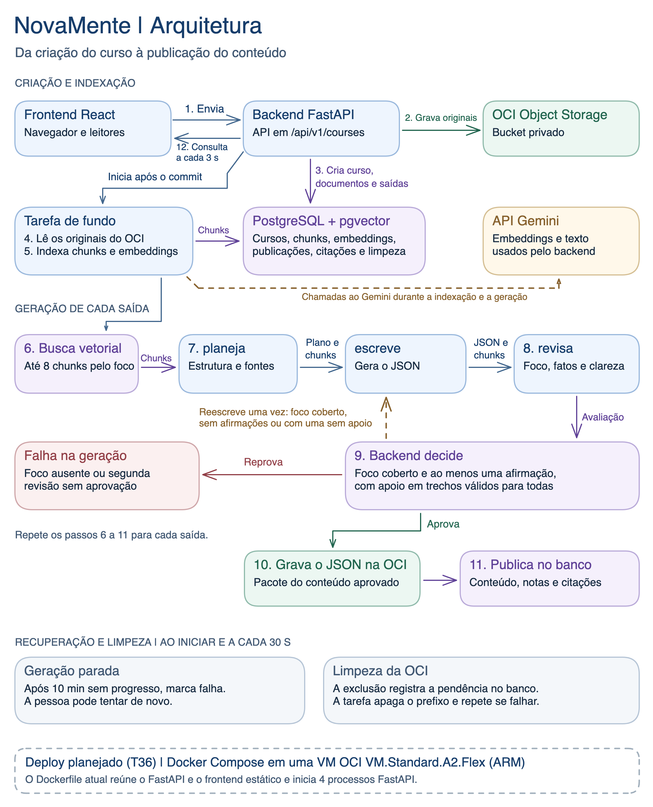

# NovaMente

O NovaMente transforma documentos técnicos em materiais de estudo revisados e adaptados ao público. A aplicação atende estudantes e pessoas que preparam treinamentos e precisam converter documentação densa em conteúdos de aprendizagem sem reescrevê-la manualmente.

## O produto

Ao criar um curso, a pessoa envia até três documentos em PDF com texto, Markdown ou texto digitado. Escolhe o título, o setor, o nível do público e um ou mais formatos: tutorial, flashcards e quiz. O sistema indexa as fontes, gera cada conteúdo e só publica os que passam pela revisão de fidelidade.

O nível de público pode ser não técnico, técnico básico ou técnico avançado. O setor pode ser Fintech, Saúde, E-commerce ou Geral. A mesma documentação pode gerar formatos e conteúdos adaptados a diferentes públicos.

## Arquitetura em nuvem

Na implantação da demonstração, a topologia é composta por:

- **Cliente web**: acessa a aplicação por HTTP na porta 80.
- **VM OCI `VM.Standard.A2.Flex` ARM64**: executa o backend FastAPI em Docker Compose. O backend serve tanto a interface React quanto a API REST na mesma origem e usa um worker.
- **PostgreSQL 18 com pgvector**: roda no Compose e mantém os dados relacionais, chunks, embeddings, estados de geração, citações e conteúdos publicados. Um volume preserva os dados entre reinícios dos contêineres.
- **OCI Object Storage**: bucket privado para documentos originais e pacotes JSON dos conteúdos publicados. Na VM, o backend autentica com identidade da instância (`instance principal`).
- **API Gemini**: recebe pedidos de embeddings e geração de texto.

A VM usa uma imagem ARM64 versionada no OCIR; o banco não publica porta para a rede pública. O acesso da demonstração é HTTP, sem HTTPS. O teste de reinicialização da VM ainda está pendente. O [guia de implantação](deployment-docker-compose.md) descreve a topologia e a operação.

## Tecnologias

- **Frontend**: React, TypeScript, Vite e TanStack Router.
- **Backend**: Python, FastAPI, SQLModel, Pydantic e Alembic.
- **Banco e busca vetorial**: PostgreSQL 18, pgvector e busca por distância de cosseno.
- **Orquestração de IA**: LangGraph.
- **Modelos**: Gemini para embeddings e geração estruturada de texto.
- **Armazenamento de objetos**: OCI Object Storage e OCI Python SDK.
- **Entrega**: Docker, Docker Compose e imagens ARM64 no OCIR.

## Como a geração usa IA

A geração combina RAG (geração aumentada por recuperação) com etapas separadas de planejamento, escrita e revisão. O backend controla o fluxo e mantém a decisão de publicação; os modelos não publicam conteúdo diretamente.

1. **Ingestão e indexação**: o backend lê os documentos do OCI, divide o texto em trechos de cerca de 1.000 caracteres e cria embeddings. Os vetores de 768 dimensões ficam no PostgreSQL junto aos trechos de origem.
2. **Recuperação contextual**: para cada saída solicitada, o sistema cria um embedding do foco do conteúdo e busca os oito trechos mais próximos entre os documentos indexados do curso.
3. **Planejamento**: o agente `planeja` propõe a estrutura e associa trechos de suporte a cada item planejado.
4. **Escrita estruturada**: o agente `escreve` recebe o plano, os trechos recuperados, o formato, o nível do público e as orientações do setor. Produz tutorial, flashcards ou quiz em um schema Pydantic estrito.
5. **Revisão de fidelidade**: o agente `revisa` confere cobertura do foco, apoio documental das afirmações técnicas e clareza. No quiz, também avalia enunciados, respostas e justificativas.
6. **Decisão e eventual reescrita**: o backend calcula a nota de fundamentação a partir das afirmações sustentadas. Se necessário, permite uma reescrita com os mesmos trechos e o mesmo plano. Conteúdo sem foco coberto ou com afirmações sem apoio após a revisão é marcado como falha e não é publicado.
7. **Publicação**: o backend grava o pacote JSON no Object Storage e, em uma transação, salva o conteúdo, as notas e as citações no banco. A interface acompanha os estados da geração.

Os prompts tratam documentos e rascunhos como dados, para que instruções encontradas nas fontes não controlem os agentes. As versões dos prompts e os modelos usados ficam registradas por conteúdo. O backend também limita o ritmo de chamadas ao Gemini e aguarda a janela de cota quando recebe HTTP 429. Testes automatizados substituem as chamadas externas por respostas determinísticas.

## Demonstração

Os casos definidos para a demonstração incluem:

- **Open Finance**: tutorial e flashcards para público não técnico e técnico avançado.
- **Regulamento do Pix**: tutorial técnico básico.
- **Lei de Acesso à Informação**: quiz técnico básico.

Consulte o [roteiro da demonstração](docs/product-specs/demonstracao.md), os [documentos e condições de uso](examples/README.md) e o [formato do pacote publicado](docs/product-specs/pacote-json-e-armazenamento.md).

## Melhorias futuras

As próximas evoluções podem ampliar a disponibilidade, a segurança e a capacidade de geração:

- habilitar HTTPS e configurar backup e restauração do banco;
- testar reinicialização e recuperação da VM, além de formalizar procedimentos de operação;
- avaliar uma fila de tarefas externa e múltiplos workers quando o volume justificar maior paralelismo;
- medir continuamente a busca e as decisões do revisor com os casos de avaliação, ajustando prompts e modelos com base nos resultados;
- avaliar leitura de imagens e diagramas, exportação de materiais e histórico de versões, hoje fora do MVP.

Essas propostas são projeções e não fazem parte da implementação descrita nesta branch.

## Desenvolvimento local

O [guia de instalação](development.md) orienta a preparação do ambiente, a configuração de Gemini e OCI e a execução local. Para executar os testes, consulte a seção correspondente do guia. O CI usa respostas determinísticas para não depender de credenciais externas.

## Documentação do projeto

- [Arquitetura e fluxo completo de geração](docs/ARCHITECTURE.md)
- [Guia de implantação na OCI](deployment-docker-compose.md)
- [Especificações do produto](docs/product-specs/index.md)
- [Esquema do banco de dados](docs/generated/db-schema.md)
- [Fluxo e tickets do projeto](docs/tickets/README.md)

Projeto da Equipe 1 do G10, Simulação No-Country. [Licença MIT](LICENSE).
