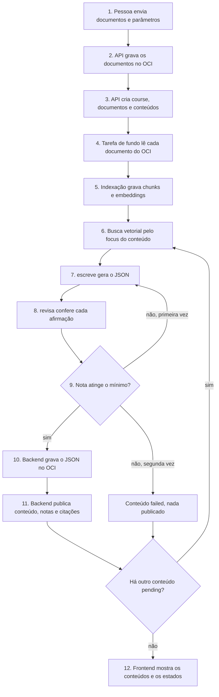

# Arquitetura do NovaMente

O NovaMente recebe um documento técnico e gera conteúdos de estudo fiéis a ele. A aplicação é um backend FastAPI que serve um frontend React, guarda dados em PostgreSQL com pgvector, guarda arquivos no OCI Object Storage e usa a API Gemini.

Este documento descreve as partes do sistema, o caminho de uma geração e as regras que o código deve manter. O esquema do banco fica em [`docs/generated/db-schema.md`](docs/generated/db-schema.md). O comportamento do produto fica em [`docs/product-specs/`](docs/product-specs/index.md).

Cada item traz um estado:

- **Existe**: está no branch `master`.
- **A construir**: a equipe decidiu, mas o código ainda não existe.

## O sistema tem cinco partes

O arquivo editável do diagrama é [`docs/assets/arquitetura.excalidraw`](docs/assets/arquitetura.excalidraw). Abra em https://excalidraw.com.

| Parte | Papel | Estado |
| --- | --- | --- |
| Frontend React | Telas de conta, cursos e conteúdos. O backend serve o build estático. | Existe para conta. A construir para cursos. |
| Backend FastAPI | API em `/api/v1`, validação, tarefa de fundo, decisão de publicar. | Existe para conta. A construir para cursos. |
| PostgreSQL 18 com pgvector | Usuários, cursos, metadados, chunks, embeddings, JSON publicado, citações e estados. | Existe: sete tabelas e migration de base. |
| OCI Object Storage | Documentos originais e JSON de cada conteúdo publicado. | A construir |
| API Gemini | Embeddings de 768 dimensões e geração de texto. | A construir |

O Traefik recebe o tráfego e encaminha para o backend. O backend é o único que fala com o banco, com o OCI e com o Gemini.

## O banco e o armazenamento de objetos dividem os dados

| Dado | PostgreSQL | OCI Object Storage |
| --- | --- | --- |
| Documento original | Metadados e chave do objeto em `source_document` | Arquivo em `courses/{course_id}/documents/{document_id}.{ext}` |
| Chunks e embeddings | `document_chunk` | Não guarda |
| Conteúdo publicado | JSON em `course_content.content` e chave em `course_content.oci_object_key` | Arquivo em `courses/{course_id}/contents/{content_id}/{uuid}.json` |
| Citações | `content_citation` | Não guarda |
| Estados e erros | Colunas `status` e `error_message` | Não guarda |

A API lê o conteúdo publicado no PostgreSQL. O arquivo no OCI atende à exigência do hackathon e serve a sistemas externos. Ele traz o conteúdo e também o formato, o nível de público, o setor, os metadados de estudo e a avaliação. `course_content.content` guarda só o conteúdo.

O CHECK `ck_course_content_published_pair` mantém as duas cópias em par: `content` e `oci_object_key` são ambos nulos ou ambos preenchidos.

## Mapa do código

| Caminho | Conteúdo | Estado |
| --- | --- | --- |
| `backend/app/models.py` | Tabelas, enums e schemas da API | Existe |
| `backend/app/alembic/versions/` | Migration de base com as sete tabelas e o seed de `niche` | Existe |
| `backend/app/api/routes/` | `login.py`, `users.py`, `utils.py`, `private.py` | Existe |
| `backend/app/api/routes/courses.py`, `niches.py` | Rotas de cursos e nichos | A construir |
| `backend/app/core/config.py` | Classe `Settings`, lida do `.env` | Existe |
| `backend/app/core/storage.py` | Único módulo que chama o OCI Python SDK | A construir |
| `backend/app/core/llm.py` | Único módulo que chama a API Gemini | A construir |
| `backend/app/services/course_generation.py` | Indexação, busca, geração e publicação | A construir |
| `backend/tests/` | Testes `pytest` contra um PostgreSQL real | Existe |
| `frontend/src/routes/` | Rotas do TanStack Router. A navegação fica no topo, com "Home" e "Novo curso" | Existe para login, cadastro, painel e configurações. A navegação no topo e `/courses/new` faltam |
| `frontend/src/client/` | Cliente HTTP gerado do OpenAPI. Não edite à mão. | Existe |
| `compose.yml`, `compose.override.yml`, `compose.deploy.yml` | Serviços `proxy`, `db`, `adminer` e `backend` | Existe |

## A criação de um curso segue doze passos

A pessoa envia um ou mais documentos e escolhe uma ou mais saídas. Cada saída vira um conteúdo do curso. O backend responde ao pedido em cerca de um segundo. O trabalho lento roda em uma tarefa de fundo (`BackgroundTasks` do FastAPI), no mesmo processo da API.

1. A pessoa envia título, nicho, nível de público, os arquivos e a lista de saídas para `POST /api/v1/courses/`. A API valida tudo antes de gravar: até 3 arquivos, até 3 saídas e uma saída de cada formato.
2. A API grava cada arquivo no OCI.
3. A API cria, em uma transação, o `course` (`initializing`), um `source_document` (`uploaded`) por arquivo e um `course_content` (`pending`) por saída. O `focus` de cada conteúdo é o título do curso. Se o `commit` falha, a API apaga os arquivos. A API responde HTTP 201 e agenda a tarefa de fundo.
4. A tarefa marca cada documento como `processing` e lê o arquivo do OCI.
5. A tarefa divide o texto em chunks de cerca de 1.000 caracteres e pede um embedding por chunk. Ela grava os chunks e o estado `indexed` na mesma transação, um documento por vez. Se um documento falha, a tarefa para e nenhum conteúdo é gerado.
6. A tarefa pega os conteúdos na ordem de `position`, um por vez, e marca o conteúdo como `running`. Ela gera o embedding de `course_content.focus` e busca os 8 chunks mais próximos. A busca usa todos os documentos `indexed` do curso com o mesmo `embedding_model`.
7. `escreve` recebe os chunks, o `audience_level`, o `prompt_hint` do nicho e o formato. Ele devolve um JSON validado por um model Pydantic.
8. `revisa` recebe o JSON e os mesmos chunks. Ele lista as afirmações técnicas, indica o chunk que sustenta cada uma e avalia a clareza.
9. O backend confere a revisão, calcula `grounding_score` e decide. Abaixo do mínimo, `escreve` recebe as afirmações reprovadas e gera uma segunda versão. Se a segunda versão também falha, o conteúdo fica `failed`.
10. O backend grava o JSON aprovado no OCI, com uma chave nova.
11. O backend grava, em uma transação, o conteúdo, as notas, as citações e `status = succeeded`. O primeiro conteúdo publicado muda `course.status` para `ready`. Se a transação falha, o backend apaga o objeto do passo 10.
12. O frontend consulta a API a cada 3 segundos enquanto algum conteúdo do curso está `pending` ou `running`.

A tarefa repete os passos 6 a 11 para cada conteúdo. Se nenhum conteúdo criado com o curso é publicado, o curso fica `failed`.

Todos os documentos do curso entram na busca de cada conteúdo. A busca devolve os 8 chunks mais próximos do `focus`, então um conteúdo pode citar só parte dos documentos.

Nenhum dos doze passos tem código ainda. A ordem de construção sugerida começa por um arquivo `.md` e um tutorial, de ponta a ponta.

## Os estados tornam a tarefa de fundo observável

| Tabela | Coluna | Caminho comum | Caminho de falha |
| --- | --- | --- | --- |
| `course` | `status` | `initializing` → `ready`, no primeiro conteúdo publicado | `initializing` → `failed`, se nenhum conteúdo inicial é publicado |
| `source_document` | `status` | `uploaded` → `processing` → `indexed` | `processing` → `failed` |
| `course_content` | `status` | `pending` → `running` → `succeeded` | `pending` ou `running` → `failed` |

Uma geração `running` ou `failed` não altera o resultado publicado antes. As colunas de `content` a `oci_object_key` só mudam em uma publicação com sucesso.

## Regras que o código mantém

As dez regras de ciclo de vida do curso ficam em [`docs/generated/db-schema.md`](docs/generated/db-schema.md), na seção "O backend garante as regras que o banco não expressa". Esta lista traz só as regras de arquitetura que aquele documento não cobre.

1. Só `backend/app/core/storage.py` chama o OCI Python SDK. Só `backend/app/core/llm.py` chama a API Gemini.
2. Os agentes só produzem texto e avaliações. O backend busca os dados, calcula a nota, decide o próximo passo e publica.
3. O backend calcula `grounding_score` como a fração das afirmações técnicas sustentadas por um chunk existente. O modelo não escreve esse número.
4. Uma afirmação marcada como sustentada sem chunk válido conta como não sustentada.
5. Um erro ou uma resposta inválida de `revisa` nunca aprova o conteúdo.
6. Analogias e exemplos do nicho não entram na nota, desde que não tragam fatos técnicos novos.
7. A reescrita usa os mesmos chunks da primeira escrita. Não há nova busca.
8. Cada conteúdo tem no máximo duas escritas e duas revisões por geração.
9. As citações publicadas são só os chunks que sustentam afirmações aprovadas. A `similarity` é o valor da busca vetorial.
10. Os prompts dizem que o documento e o rascunho são dados. Os agentes ignoram instruções escritas dentro deles.
11. Nenhum JSON reprovado vai para o OCI nem para `course_content.content`.

Nenhuma destas regras tem código ainda.

## Falhas e recuperação

| Falha | O que o sistema faz |
| --- | --- |
| Validação da entrada | A API responde HTTP 422 ou 404 e não grava nada. |
| `commit` da criação falha | A API apaga o arquivo já enviado ao OCI. |
| Exceção na tarefa de fundo | A tarefa faz `rollback`, abre uma sessão nova e marca como `failed` o documento ou o conteúdo, com `error_message`. Se nenhum conteúdo inicial é publicado, marca também o curso. |
| Conteúdo reprovado duas vezes | O conteúdo fica `failed`. `error_message` lista as afirmações reprovadas. |
| Processo cai durante a geração | A geração conta como interrompida quando nenhum conteúdo do curso muda de estado por 10 minutos e algum está `pending` ou `running`. O backend marca esses conteúdos como `failed` na próxima consulta ao curso. |
| Nova tentativa | A pessoa pede a nova tentativa de um conteúdo. O backend muda o conteúdo de `failed` para `pending` em uma única operação. Um segundo pedido recebe HTTP 409. A tarefa só indexa de novo o documento que não está `indexed`. |
| Exclusão de curso | O backend recusa com HTTP 409 se há geração ativa. Depois apaga as linhas e, em tarefa de fundo, os objetos sob `courses/{course_id}/`. |
| Exclusão de conta | `DELETE /api/v1/users/me` já existe e apaga os cursos em cascata. O backend precisa coletar os `course_id` antes e fazer a mesma limpeza. |
| Limpeza no OCI falha | O backend registra o `course_id` e o erro no log. O objeto fica sem uso. |

Só a exclusão de conta sem limpeza existe hoje. O resto desta tabela está a construir.

O tempo de 10 minutos é uma estimativa. A equipe ajusta depois de medir o pior caso de uma geração.

A tarefa de fundo não sobrevive a uma queda do processo e não tenta de novo sozinha. A equipe aceita esse limite para 10 usuários.

A regra dos 10 minutos olha o `updated_at` mais recente entre os conteúdos do curso. Um conteúdo que espera a vez não conta sozinho como interrompido.

`source_document` não tem `updated_at`. A regra cobre a indexação feita na criação do curso. Um documento adicionado depois a um curso pronto vai precisar de outra regra.

## Armazenamento de objetos

O backend usa o OCI Python SDK (`oci`). Não há servidor local de armazenamento.

- **Buckets**: um para desenvolvimento e um para produção. Os nomes `novamente-dev` e `novamente-prod` são uma proposta.
- **Desenvolvimento**: cada pessoa usa uma API signing key própria, guardada fora da pasta do repositório.
- **Produção**: o backend usa um instance principal. A VM recebe a permissão por um dynamic group e uma policy. Nenhuma chave do OCI fica na VM.
- **Testes e CI**: os testes trocam `storage.py` por uma versão que guarda os arquivos em um dicionário Python. O CI não usa credenciais do OCI.
- **Verificação real**: um script envia, lê, lista e apaga um arquivo no bucket de desenvolvimento. Rode depois de mudar `storage.py` e uma vez na VM.

`storage.py` precisa de quatro operações: gravar, ler, apagar e listar por prefixo. A listagem lê todas as páginas do resultado.

## Modelos de IA

- **Embeddings**: `gemini-embedding-2`, com 768 dimensões. `source_document.embedding_model` guarda o nome do modelo de cada documento.
- **Texto**: um modelo Gemini definido em `GEMINI_GENERATION_MODEL`. A equipe ainda não escolheu o modelo.
- **Chave**: `GEMINI_API_KEY` é opcional. Sem ela, a geração falha com uma mensagem clara, e os testes e o CI sobem o backend.
- **Versões**: `course_content.llm_model` e `course_content.prompt_version` registram o modelo e a versão dos prompts de cada geração.

Cada conteúdo usa até quatro chamadas de texto. Um curso com três saídas usa até doze, além dos embeddings dos chunks e do `focus`. Os limites do plano gratuito do Gemini não foram conferidos.

## Implantação

O destino é uma VM Ampere A1 da camada Always Free da OCI, com Docker Compose. Nada disso existe ainda.

| Ponto | Hoje no repositório | Decisão |
| --- | --- | --- |
| Adminer | `compose.yml` publica em `adminer.${DOMAIN}` | Tirar da produção |
| Processos do backend | `backend/Dockerfile` inicia 4 | Começar com 2 e medir |
| HTTPS | O Traefik emite o certificado e exige um domínio | Usar um subdomínio gratuito |
| Deploy automático | `deploy-docker-compose.yml` usa um runner `self-hosted` | Desativar. Deploy manual por SSH com um script |
| Backup | Não existe | `pg_dump` diário enviado ao OCI Object Storage |
| Banco | Sem porta pública em `compose.yml` | Manter. Dados em volume Docker |
| Rede | Não existe | Abrir só 80 e 443. Limitar o SSH aos IPs da equipe |

A equipe usa só recursos marcados como Always Free e não muda a conta para Pay As You Go. Uma única VM é um ponto único de falha, e a equipe aceita esse risco.

## Segurança

- **Acesso**: login com e-mail e senha e token JWT. Toda rota de curso exige usuário autenticado.
- **Dono do curso**: toda leitura e toda busca vetorial filtram por `course.owner_id`. Um curso de outro usuário responde HTTP 404.
- **Segredos**: chaves ficam no `.env` de cada máquina. O repositório é público e tem só o `.env.example`.
- **Documentos**: a equipe usa só documentos públicos ou fictícios, porque o plano gratuito do modelo pode usar os dados enviados.
- **Banco**: o PostgreSQL não tem porta pública em produção.

## Testes

- **Backend**: `pytest` contra o PostgreSQL do Compose. O CI exige 90% de cobertura de `backend/app`.
- **Esquema**: `backend/tests/test_schema.py` compara o catálogo do PostgreSQL com o ERD.
- **Modelo**: os testes trocam as funções de `llm.py` por funções determinísticas. Nenhum teste automático chama a API Gemini.
- **Frontend**: Playwright contra o backend do Compose, sem chave Gemini.
- **Revisor**: um conjunto de casos com erros plantados mede o revisor com o modelo real. Roda à mão, fora do CI. A construir.

## Decisões

| Decisão | Motivo | Estado |
| --- | --- | --- |
| Partir do `full-stack-fastapi-template` | Conta, login e cliente gerado já vêm prontos. | Existe |
| Um só banco: PostgreSQL com pgvector | Evita operar um vector store separado. | Existe |
| Busca exata, sem índice HNSW | Cerca de 15.000 chunks na escala planejada. | Existe |
| Gemini para embeddings e texto | Uma só chave e um só cliente. | A construir |
| Tarefa de fundo com `BackgroundTasks` | Uma fila externa é uma peça a mais para 10 usuários. | A construir |
| JSON publicado no banco e no OCI | A API lê do banco. O OCI atende ao hackathon. | A construir |
| OCI Python SDK, sem MinIO e sem `boto3` | Permite instance principal na VM e testa o OCI desde o início. | A construir |
| `escreve` e `revisa`, com uma reescrita | A promessa do produto é fidelidade ao documento. | A construir |
| Não publicar conteúdo reprovado | Conteúdo errado com aparência de pronto é pior que um erro claro. | A construir |
| Um curso por nível de público | O esquema já fixa `audience_level` no curso. | Existe no esquema |
| Limite de 10 minutos e nova tentativa manual | A tarefa de fundo não avisa quando morre. | A construir |
| Exclusão: banco primeiro, OCI depois | Uma falha deixa um arquivo sem uso, não um curso quebrado. | A construir |
| Uma VM Always Free com Docker Compose | Atende ao deploy em nuvem com poucas peças. | A construir |
| LangGraph para o laço de escrita e revisão | O briefing lista agentes com LangGraph como diferencial, e o grafo deixa o fluxo visível. | A construir |
| Etapa `planeja` depois de `escreve` e `revisa` | O briefing trata a cadeia de planejar, redigir e revisar como adicional. `planeja` só propõe a estrutura do conteúdo e entra antes da demonstração. | A construir |
| Nomes em inglês no JSON e na API | O exemplo do briefing é só um exemplo. O produto usa os nomes do esquema. | A construir |
| Vários documentos e várias saídas por curso | A pessoa escolhe os documentos e as saídas na criação. Todos os documentos valem para todas as saídas. | A construir |
| Até 3 documentos e até 3 saídas, uma de cada formato | Todas as saídas têm o mesmo foco. Cada saída usa até quatro chamadas ao modelo. | A construir |
| Até 5 MiB por arquivo e 150 mil caracteres de texto por documento | Mantém cada documento perto da escala prevista no esquema. | A construir |
| Arquivo no OCI com conteúdo, metadados e avaliação | Um sistema externo entende o arquivo sem consultar o banco. | A construir |
| Nota mínima de 0,80 | Ponto de partida. A equipe mede com os casos de avaliação, ajusta e registra cada mudança. | A construir |

Os limites de documentos, de saídas e de formato são regras da API. O banco não os impõe.

## O que fica fora desta arquitetura

- Fila externa de tarefas, como Celery ou RQ.
- Servidor local de armazenamento de objetos.
- Vector store separado, como Chroma ou FAISS.
- Histórico de versões de um conteúdo. Uma regeneração substitui a mesma linha.
- Trilha de conteúdos proposta pelo modelo.
- Campo de nível de detalhe na entrada.
- Leitura de imagens e diagramas do documento.
