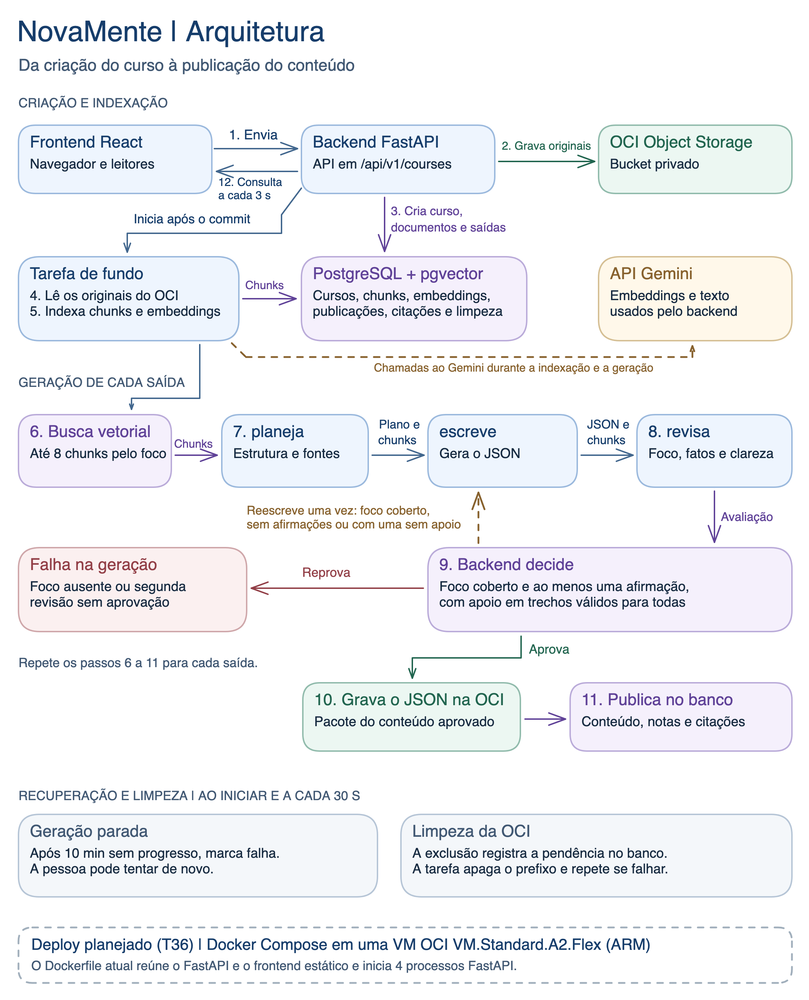
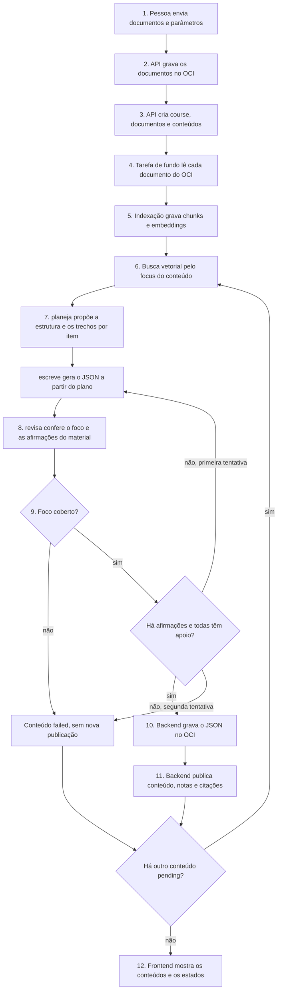

# Arquitetura do NovaMente

O NovaMente recebe um documento técnico e gera conteúdos de estudo fiéis a ele. A aplicação combina um frontend React, um backend FastAPI, PostgreSQL com pgvector, OCI Object Storage e a API Gemini.

Este documento descreve as partes do sistema, o caminho de uma geração e as regras que o código deve manter. O esquema do banco fica em [`generated/db-schema.md`](generated/db-schema.md). O comportamento do produto fica em [`product-specs/`](product-specs/index.md).

Cada item traz um estado:

- **Existe**: está no branch `master`.
- **A construir**: a equipe decidiu, mas o código ainda não existe.

## O sistema tem cinco partes

O arquivo editável do diagrama é [`system-diagram/arquitetura.excalidraw`](system-diagram/arquitetura.excalidraw). Abra em https://excalidraw.com.

| Parte | Papel | Estado |
| --- | --- | --- |
| Frontend React | Telas de conta, cursos e leitores. O backend serve o build estático e o Vite serve o frontend no desenvolvimento local. | Existe |
| Backend FastAPI | API em `/api/v1`, validação, geração em segundo plano, publicação, recuperação e limpeza. | Existe |
| PostgreSQL 18 com pgvector | Usuários, cursos, chunks, embeddings, JSON publicado, citações, estados e pendências de limpeza. | Existe |
| OCI Object Storage | Documentos originais e JSON de cada conteúdo publicado. | Existe |
| API Gemini | Embeddings de 768 dimensões e geração de texto. | Existe |

O backend acessa o banco, o OCI e o Gemini. O Traefik encaminha o tráfego para o backend no Compose de desenvolvimento.

## O banco e o armazenamento de objetos dividem os dados

| Dado | PostgreSQL | OCI Object Storage |
| --- | --- | --- |
| Documento original | Metadados e chave do objeto em `source_document` | Arquivo em `courses/{course_id}/documents/{document_id}.{ext}` |
| Chunks e embeddings | `document_chunk` | Não guarda |
| Conteúdo publicado | JSON em `course_content.content` e chave em `course_content.oci_object_key` | Arquivo em `courses/{course_id}/contents/{content_id}/{uuid}.json` |
| Citações | `content_citation` | Não guarda |
| Estados e erros | Colunas `status` e `error_message` | Não guarda |

A API lê o conteúdo publicado no PostgreSQL. O arquivo no OCI atende à exigência do hackathon e serve a sistemas externos. Ele traz o conteúdo e também o formato, o nível de público, o setor, os metadados de estudo e a avaliação. `course_content.content` guarda só o conteúdo.

O CHECK `ck_course_content_published_pair` mantém as duas cópias em par: `content` e `oci_object_key` são ambos nulos ou ambos preenchidos.

## Mapa do código

| Caminho | Conteúdo | Estado |
| --- | --- | --- |
| `backend/app/models.py` | Tabelas, enums e schemas da API | Existe |
| `backend/app/alembic/versions/` | Migrations do esquema, com a base do ERD v5, o seed de `niche` e as mudanças de recuperação e limpeza | Existe |
| `backend/app/api/routes/` | Rotas de conta, cursos, setores, utilitários e seed de desenvolvimento | Existe |
| `backend/app/core/config.py` | Classe `Settings`, lida do `.env` | Existe |
| `backend/app/core/storage.py` | Único módulo que chama o OCI Python SDK | Existe |
| `backend/app/core/llm.py` | Único módulo que chama a API Gemini | Existe |
| `backend/app/services/course_generation.py` | Indexação, busca, geração, publicação e recuperação de gerações paradas | Existe |
| `backend/app/services/generation_graph.py` | Grafo LangGraph com `planeja`, `escreve` e `revisa` | Existe |
| `backend/app/services/course_deletion.py` | Fila persistente e limpeza periódica dos objetos do curso | Existe |
| `backend/tests/` | Testes `pytest` contra um PostgreSQL real | Existe |
| `frontend/src/routes/` | Rotas do TanStack Router para conta, lista de cursos, novo curso e leitores | Existe |
| `frontend/src/client/` | Cliente HTTP gerado do OpenAPI. Não edite à mão. | Existe |
| `compose.yml`, `compose.override.yml`, `compose.deploy.yml` | Backend e banco comuns, Traefik e Adminer no desenvolvimento, porta HTTP 80 no deploy | Existe |
| `compose.playwright.yml` | Sobreposição que monta o servidor de teste do Playwright | Existe |
| `scripts/deploy.sh` | Atualização do clone, build, migração e subida do Compose | Existe |

## A criação de um curso segue doze passos

A pessoa envia um ou mais documentos e escolhe uma ou mais saídas. Cada saída vira um conteúdo do curso. O backend responde depois de gravar os documentos e confirmar a criação no banco. O trabalho lento roda em uma tarefa de fundo (`BackgroundTasks` do FastAPI), no mesmo processo da API.

1. A pessoa envia título, nicho, nível de público, os arquivos e a lista de saídas para `POST /api/v1/courses/`. A API valida tudo antes de gravar: até 3 arquivos, até 3 saídas e uma saída de cada formato.
2. A API grava cada arquivo no OCI.
3. A API cria, em uma transação, o `course` (`initializing`), um `source_document` (`uploaded`) por arquivo e um `course_content` (`pending`) por saída. O `focus` de cada conteúdo é o título do curso. Se o `commit` falha, a API apaga os arquivos. A API responde HTTP 201 e agenda a tarefa de fundo.
4. A tarefa marca cada documento como `processing` e lê o arquivo do OCI.
5. A tarefa divide o texto em chunks de cerca de 1.000 caracteres e pede um embedding por chunk. Ela grava os chunks e o estado `indexed` na mesma transação, um documento por vez. Se um documento falha, a tarefa para e nenhum conteúdo é gerado.
6. A tarefa pega os conteúdos na ordem de `position`, um por vez, e marca o conteúdo como `running`. Ela gera o embedding de `course_content.focus` e busca os 8 chunks mais próximos. A busca usa todos os documentos `indexed` do curso com o mesmo `embedding_model`.
7. `planeja` propõe a estrutura do conteúdo e indica os trechos que sustentam cada item. `escreve` segue o plano usando os chunks, o `audience_level`, o `prompt_hint` do nicho e o formato. Ele devolve um JSON validado por um model Pydantic.
8. `revisa` recebe o material de estudo, o foco, o nível de público e os mesmos chunks. Para quiz, o material traz o enunciado, a resposta marcada e a justificativa de cada pergunta. O revisor verifica se o material trata do foco, usa os chunks para conferir as afirmações técnicas e avalia a clareza.
9. O backend calcula `grounding_score` e decide. Se o foco não é coberto, o conteúdo fica `failed` de imediato. Com foco coberto, o backend aprova se a revisão lista pelo menos uma afirmação e todas têm apoio em chunks válidos. Se a primeira revisão não lista afirmações ou alguma fica sem apoio, `escreve` gera uma segunda versão com a lista de afirmações sem apoio. Se a segunda revisão ainda falha, o conteúdo fica `failed`.
10. O backend grava o JSON aprovado no OCI, com uma chave nova.
11. O backend grava, em uma transação, o conteúdo, as notas, as citações e `status = succeeded`. O primeiro conteúdo publicado muda `course.status` para `ready`. Se a transação falha, o backend apaga o objeto do passo 10.
12. O frontend consulta a API a cada 3 segundos enquanto algum conteúdo do curso está `pending` ou `running`.

A tarefa repete os passos 6 a 11 para cada conteúdo. Se nenhum conteúdo criado com o curso é publicado, o curso fica `failed`.

Todos os documentos do curso entram na busca de cada conteúdo. A busca devolve os 8 chunks mais próximos do `focus`, então um conteúdo pode citar só parte dos documentos.

A rota de criação agenda a tarefa de fundo após confirmar a transação.

## Os estados tornam a tarefa de fundo observável

| Tabela | Coluna | Caminho comum | Caminho de falha |
| --- | --- | --- | --- |
| `course` | `status` | `initializing` → `ready`, no primeiro conteúdo publicado | `initializing` → `failed` quando a fila acaba sem publicação. Uma nova tentativa muda `failed` → `initializing`. |
| `source_document` | `status` | `uploaded` → `processing` → `indexed` | `processing` → `failed` |
| `course_content` | `status` | `pending` → `running` → `succeeded` | `pending` ou `running` → `failed` |

Uma geração `running` ou `failed` não altera o resultado publicado antes. As colunas de `content` a `oci_object_key` só mudam em uma publicação com sucesso.

## Regras que o código mantém

As dez regras de ciclo de vida do curso ficam em [`generated/db-schema.md`](generated/db-schema.md), na seção "O backend garante as regras que o banco não expressa". Esta lista traz só as regras de arquitetura que aquele documento não cobre.

1. Só `backend/app/core/storage.py` chama o OCI Python SDK. Só `backend/app/core/llm.py` chama a API Gemini.
2. Os agentes só produzem texto e avaliações. O backend busca os dados, calcula a nota, decide o próximo passo e publica.
3. O backend calcula `grounding_score` como a fração das afirmações técnicas sustentadas por um chunk válido. Para publicar, o material deve cobrir o foco com apoio nos chunks, a revisão deve listar pelo menos uma afirmação e todas devem ter apoio em chunks válidos. Cada nova publicação tem nota 1,00.
4. Uma afirmação marcada como sustentada sem chunk válido conta como não sustentada.
5. Um erro ou uma resposta inválida de `revisa` nunca aprova o conteúdo.
6. Analogias e exemplos do nicho não entram na nota, desde que não tragam fatos técnicos novos.
7. A reescrita usa os mesmos chunks e o mesmo plano da primeira escrita.
8. Cada conteúdo tem no máximo um plano, duas escritas e duas revisões por geração.
9. As citações publicadas são só os chunks que sustentam afirmações aprovadas. A `similarity` é o valor da busca vetorial.
10. Os prompts tratam o documento, o plano e o rascunho como dados. `planeja` e `revisa` também tratam o foco como dado. Os agentes ignoram instruções escritas nesses dados.
11. Nenhum JSON reprovado vai para o OCI nem para `course_content.content`.

## Falhas e recuperação

| Falha | O que o sistema faz |
| --- | --- |
| Validação da entrada | A API responde HTTP 422 ou 404 e não grava nada. |
| `commit` da criação falha | A API apaga o arquivo já enviado ao OCI. |
| Falha de indexação | A tarefa para e marca os conteúdos `pending` como `failed`, com “O conteúdo não foi gerado, porque um documento do curso falhou.” Se o curso ainda está `initializing`, sem publicação e sem conteúdo `pending` ou `running`, ele fica `failed`. |
| Exceção na tarefa de fundo | A tarefa faz `rollback`, abre uma sessão nova e marca como `failed` o documento ou o conteúdo, com `error_message`. Se nenhum conteúdo inicial é publicado, marca também o curso. |
| Material sem cobertura do foco na revisão | O conteúdo fica `failed` de imediato, com “O documento não trata do assunto pedido.” |
| Segunda revisão sem afirmações | O conteúdo fica `failed`, com “O documento não trata do assunto pedido.” |
| Segunda revisão com foco coberto e afirmações sem apoio | O conteúdo fica `failed`. `error_message` começa com “Afirmações sem apoio no documento:” e lista cada afirmação sem apoio em uma linha. |
| Processo cai durante a geração | Após 10 minutos sem progresso, o backend marca os conteúdos `pending` ou `running` e os documentos `processing` como `failed`. |
| Nova tentativa | A API muda o conteúdo de `failed` para `pending` sob o lock do curso. O conteúdo entra na fila ativa ou a API agenda uma tarefa após o `commit`. Um segundo pedido recebe HTTP 409. |
| Exclusão de curso | A API responde HTTP 409 se há conteúdo na fila ou em geração. Caso contrário, apaga o curso em cascata e registra a limpeza de `courses/{course_id}/` na mesma transação. |
| Exclusão de conta | A API responde HTTP 409 se algum curso tem conteúdo na fila ou em geração. Caso contrário, apaga a conta em cascata e registra uma pendência por curso na mesma transação. |
| Limpeza no OCI falha | A tarefa de fundo busca pendências ao iniciar e a cada 30 segundos. Se a OCI falhar, registra os metadados do erro e tenta de novo após pelo menos um minuto. |

A exclusão grava uma linha em `course_object_cleanup` por curso na mesma transação que apaga os dados do banco. A pendência sobrevive à exclusão e a reinícios. O backend a remove depois de listar e apagar os objetos do prefixo.

O UUID interno `course.generation_id` identifica a tarefa que pode gravar resultados. A tarefa valida o UUID e o prazo sob o lock do curso antes de gravar. Quando encerra, limpa o UUID na mesma transação.

O backend recupera gerações paradas na inicialização e a cada 30 segundos. A recuperação fecha a fila e limpa o UUID na mesma transação. Linhas antigas sem UUID seguem o mesmo prazo. A pessoa inicia a nova tentativa pela tela do curso.

O prazo usa o `updated_at` mais recente entre os conteúdos do curso. Sob o lock do curso, a tarefa atualiza o `updated_at` das saídas na fila na mesma transação que grava os chunks e marca cada documento como `indexed`. Cada documento concluído renova o prazo. Se a indexação ficar 10 minutos sem registrar progresso, a recuperação encerra a geração. A recuperação preserva publicações anteriores.

O tempo de 10 minutos é uma estimativa. A equipe ajusta depois de medir o pior caso de uma geração.

`source_document` não tem `updated_at`. A regra cobre a indexação na criação do curso e na nova tentativa. Um documento adicionado depois a um curso pronto vai precisar de outra regra.

## Armazenamento de objetos

O backend usa o OCI Python SDK (`oci`). Não há servidor local de armazenamento.

- **Buckets**: um para desenvolvimento e um para produção. O de desenvolvimento é `novamente-docs`, privado, na região `sa-saopaulo-1`. O nome `novamente-prod` é uma proposta.
- **Desenvolvimento**: cada pessoa usa uma API signing key própria, guardada fora da pasta do repositório.
- **Produção planejada**: o SDK já aceita `instance_principal`. A configuração do acesso ao bucket na VM faz parte do T36.
- **Testes e CI**: os testes trocam `storage.py` por uma versão que guarda os arquivos em um dicionário Python. O CI não usa credenciais do OCI.
- **Verificação real**: `backend/scripts/verify_storage.py` envia, lê, lista e apaga um arquivo no bucket de desenvolvimento. Rode no ambiente de desenvolvimento depois de alterar o acesso ao armazenamento. Em 19/11/2026, as quatro operações passaram em `novamente-docs` com uma API signing key própria.

`storage.py` precisa de quatro operações: gravar, ler, apagar e listar por prefixo. A listagem lê todas as páginas do resultado.

## Modelos de IA

- **Embeddings**: `gemini-embedding-2`, com 768 dimensões. `source_document.embedding_model` guarda o nome do modelo de cada documento.
- **Texto**: `gemini-3.5-flash-lite`, definido em `GEMINI_GENERATION_MODEL`. Em 19/11/2026, a API aceitou o schema de `GeneratedTutorial`, `GeneratedFlashcards`, `GeneratedQuiz` e da revisão, e todas as respostas validaram no Pydantic com `strict=True`. Isso confirma a estrutura, não a fidelidade nem a qualidade do texto.
- **Chave**: `GEMINI_API_KEY` é opcional. Sem ela, a geração falha com uma mensagem clara, e os testes e o CI sobem o backend.
- **Versões**: `course_content.llm_model` e `course_content.prompt_version` registram o modelo e a versão dos prompts de cada geração.

Cada conteúdo usa até cinco chamadas de texto. Um curso com três saídas usa até quinze, além dos embeddings dos chunks e do `focus`.

Limites do plano gratuito, lidos no Google AI Studio em 19/11/2026:

| Modelo | Pedidos por minuto | Tokens por minuto | Pedidos por dia |
| --- | ---: | ---: | ---: |
| `gemini-embedding-2` | 100 | 30.000 | 1.000 |
| `gemini-3.5-flash-lite` | 15 | 250.000 | 500 |

A cota de embeddings conta cada texto como um pedido, mesmo dentro de um lote: uma chamada com 1 texto e outra com 20 apareceram como 21 pedidos. Com chunks de 1.000 caracteres, um documento de 100 mil caracteres gasta cerca de 101 pedidos de embeddings.

Os embeddings limitam a capacidade diária, não o texto. Sem contar novas tentativas de transporte do cliente, a cota de texto comporta 33 cursos por dia (500 / 15). Os embeddings comportam cerca de 9 cursos com um documento de 100 mil caracteres, ou 2 cursos no tamanho máximo, com 3 documentos de 150 mil caracteres. Basta para a demonstração.

`llm.py` controla o ritmo por minuto antes de cada pedido e espera a janela terminar em HTTP 429 (T39). Sem esse controle, a indexação de um documento com mais de cerca de 90 mil caracteres passa do limite por minuto e falha.

## Implantação

A configuração de deploy combina `compose.yml` e `compose.deploy.yml`. Só o backend publica uma porta, TCP 80. Ele serve o frontend e a API por HTTP na mesma origem e roda com um worker para compartilhar os limites do Gemini. O PostgreSQL usa um volume persistente. Traefik e Adminer ficam no Compose de desenvolvimento.

O [guia de deploy](../deployment-docker-compose.md) usa SSH e `scripts/deploy.sh`. HTTPS e backup ficam fora do escopo da demonstração de hackathon. A equipe aceita tráfego sem criptografia e usa credenciais exclusivas da demonstração e dados descartáveis.

A [Parte 2 do T36](tickets/T36-deploy-na-vm-da-oci.md#parte-2---pessoa) prevê publicar na VM `VM.Standard.A2.Flex` (arm64), configurar rede e identidade da instância, e validar o acesso HTTP por IP, o quiz, a exclusão e o reinício. A rede deve abrir só a porta 80 para o público e a 22 para o IP da pessoa que faz o deploy. [Referência da VM](https://docs.oracle.com/en-us/iaas/Content/Compute/References/arm.htm).

A A2.Flex é uma [exceção à regra Always Free do briefing](product-specs/escopo-do-mvp.md#restrições). Uma única VM é um ponto único de falha, e a equipe aceita esse risco.

## Segurança

- **Acesso**: login com e-mail e senha e token JWT. Toda rota de curso exige usuário autenticado.
- **Dono do curso**: toda leitura e toda busca vetorial filtram por `course.owner_id`. Um curso de outro usuário responde HTTP 404.
- **Segredos**: chaves ficam no `.env` de cada máquina. O repositório é público e tem só o `.env.example`.
- **Documentos**: a equipe usa só documentos públicos ou fictícios, porque o plano gratuito do modelo pode usar os dados enviados.
- **Banco**: o PostgreSQL não tem porta pública em produção.

## Testes

- **Backend**: `pytest` contra o PostgreSQL do Compose. O CI exige 90% de cobertura de `backend/app`.
- **Esquema**: `backend/tests/test_schema.py` confere o catálogo do PostgreSQL após as migrations.
- **Modelo**: os testes trocam as funções de `llm.py` por funções determinísticas. Nenhum teste automático chama a API Gemini.
- **Frontend**: O Playwright usa Chromium, a API do produto e PostgreSQL com pgvector. `compose.playwright.yml` monta um ponto de entrada de teste que substitui o OCI por armazenamento em memória e as chamadas ao Gemini por respostas determinísticas. A tarefa de fundo, a busca, o grafo, o cálculo da nota e a publicação usam o código do produto. O CI roda a suíte completa com a sobreposição.

  O [guia de instalação](../development.md#5-rode-os-testes) traz o comando dos dois cenários.

- **Avaliação**: [`backend/scripts/evaluate.py`](../backend/scripts/evaluate.py). O script mede a busca, o revisor e a geração com o modelo real, a partir dos [casos de avaliação](../examples/evals/README.md). Roda à mão, fora do CI.

## Decisões

| Decisão | Motivo | Estado |
| --- | --- | --- |
| Partir do `full-stack-fastapi-template` | Conta, login e cliente gerado já vêm prontos. | Existe |
| Um só banco: PostgreSQL com pgvector | Evita operar um vector store separado. | Existe |
| Busca exata, sem índice HNSW | Cerca de 15.000 chunks na escala planejada. | Existe |
| Gemini para embeddings e texto | Uma só chave e um só cliente. | Existe |
| Tarefa de fundo com `BackgroundTasks` | Uma fila externa é uma peça a mais para 10 usuários. | Existe |
| JSON publicado no banco e no OCI | A API lê do banco. O OCI atende ao hackathon. | Existe |
| OCI Python SDK, sem MinIO e sem `boto3` | Permite instance principal na VM e testa o OCI desde o início. | Existe |
| `escreve` e `revisa`, com até uma reescrita | A promessa do produto é fidelidade ao documento. | Existe |
| Não publicar conteúdo reprovado | Conteúdo errado com aparência de pronto é pior que um erro claro. | Existe |
| Um nível de público por curso | O esquema fixa `audience_level` no curso. | Existe |
| Limite de 10 minutos e nova tentativa manual | A tarefa de fundo não avisa quando morre. | Existe |
| Exclusão: banco primeiro, OCI depois | Uma falha deixa um arquivo sem uso, não um curso quebrado. | Existe |
| Deploy em VM `VM.Standard.A2.Flex` (ARM) com Docker Compose | Destino do T36. | A construir |
| LangGraph para o laço de escrita e revisão | O briefing lista agentes com LangGraph como diferencial, e o grafo deixa o fluxo visível. | Existe |
| Etapa `planeja` antes de `escreve` | O briefing trata a cadeia de planejar, redigir e revisar como adicional. `planeja` só propõe a estrutura do conteúdo. | Existe |
| Nomes em inglês no JSON e na API | O exemplo do briefing é só um exemplo. O produto usa os nomes do esquema. | Existe |
| Vários documentos e várias saídas por curso | A pessoa escolhe os documentos e as saídas na criação. Todos os documentos valem para todas as saídas. | Existe |
| Até 3 documentos e até 3 saídas, uma de cada formato | Todas as saídas têm o mesmo foco. Cada saída usa até cinco chamadas de texto ao modelo. | Existe |
| Até 5 MiB por arquivo e 150 mil caracteres de texto por documento | Mantém cada documento perto da escala prevista no esquema. | Existe |
| Arquivo no OCI com conteúdo, metadados e avaliação | Um sistema externo entende o arquivo sem consultar o banco. | Existe |
| Publicar só com foco coberto e pelo menos uma afirmação, todas com apoio | Em 19/11/2026, a regra anterior aprovou um tutorial com dois fatos falsos e outro que fugiu do foco. | Existe |

Os limites de documentos, de saídas e de formato são regras da API. O banco não os impõe.

## O que fica fora desta arquitetura

- Fila externa de tarefas, como Celery ou RQ.
- Servidor local de armazenamento de objetos.
- Vector store separado, como Chroma ou FAISS.
- Histórico de versões de um conteúdo. Uma regeneração substitui a mesma linha.
- Trilha de conteúdos proposta pelo modelo.
- Campo de nível de detalhe na entrada.
- Leitura de imagens e diagramas do documento.
