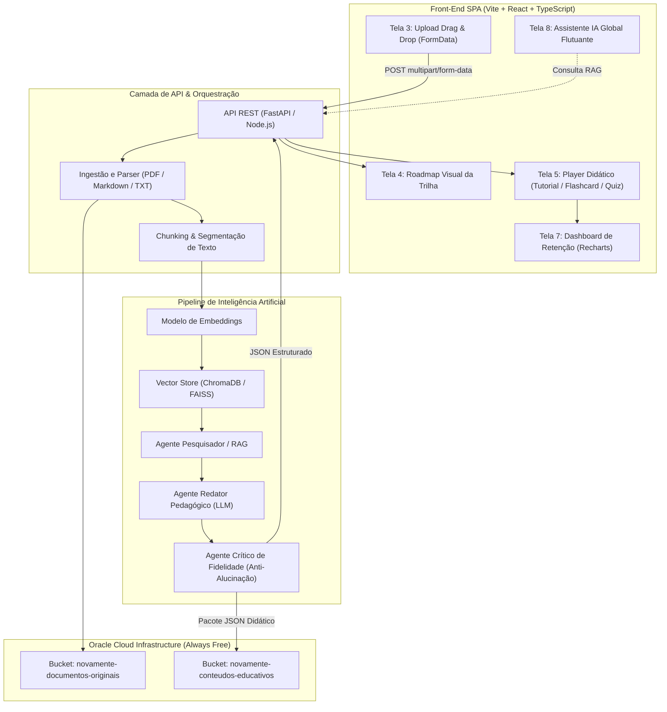

# 📋 Dossiê Técnico e Relatório de Escopo — Projeto NovaMente

**Hackathon ONE (Oracle Next Education & Alura) — Grupo 10**  
**Projeto:** NovaMente — Sistema Inteligente de Adaptação e Geração de Conteúdo Educacional  
**Parceria:** Oracle Cloud Infrastructure (OCI) & Alura  
**Data:** Outubro de 2026  
**Status:** Planejamento e Arquitetura Concluídos — Pronto para Implementação  

---

## 1. Identificação do Projeto e Equipe

* **Nome da Solução:** NovaMente
* **Segmento / Indústria:** EdTech / Treinamento Corporativo / Formação Técnica Acelerada
* **Objetivo:** Ingerir documentações técnicas densas (manuais, PDFs, artigos e arquivos Markdown) e transformá-las, via pipeline inteligente de RAG e Agentes de IA, em trilhas didáticas interativas personalizadas para diferentes níveis de senioridade técnica e formatos pedagógicos.
* **Infraestrutura Cloud:** Oracle Cloud Infrastructure (OCI) — Camada Always Free (Object Storage para persistência de documentos técnicos brutos e pacotes educacionais JSON).
* **Frentes de Desenvolvimento:**
  * **Front-End & UX:** Marcos & Joel
  * **Back-End, RAG & Agentes:** Equipe Back-End G10
  * **Infraestrutura OCI & Persistência:** Equipe DevOps/Cloud G10

---

## 2. Escopo do Projeto e Problema de Negócio

### 2.1 A Dor do Mercado
Empresas de tecnologia e instituições de ensino produzem vastas quantidades de documentação técnica (manuais de nuvem, guias de arquitetura, documentações de APIs). No entanto, transformar esse conhecimento bruto em material pedagógico para:
- Um estagiário ou iniciante em transição de carreira;
- Um desenvolvedor pleno que precisa de tutoriais diretos e código prático;
- Um líder técnico ou arquiteto que necessita de visão holística e trade-offs;
- Um gestor executivo que precisa de resumos de alto nível (TL;DR);
é um processo moroso que consome **semanas de especialistas e designers instrucionais**.

### 2.2 A Proposta de Valor da NovaMente
A NovaMente reduz o tempo de geração de conteúdo educacional de **semanas para minutos**, assegurando:
1. **Fidelidade Técnica Absoluta (Zero Alucinação):** RAG ancorado com embeddings nas fontes técnicas originais;
2. **Didática Adaptativa:** Tom de voz, profundidade e analogias ajustadas ao perfil selecionado;
3. **Multiformato:** O mesmo conceito técnico pode ser estudado como Tutorial, Flashcards 3D de repetição espaçada, Quiz interativo com justificativas, ou Resumo Executivo;
4. **Assistência Contínua:** Assistente IA contextualizado com FAQ e citação de fontes em tempo real;
5. **Aderência aos Requisitos Always Free da OCI:** Persistência escalável com custo zero.

---

## 3. Arquitetura Geral da Solução

---

## 4. Matriz de Atendimento aos Requisitos Oficiais do Hackathon

| Categoria | Requisito Oficial (Edital Hackathon ONE G10) | Situação NovaMente | Como Atendemos na Aplicação |
| :--- | :--- | :--- | :--- |
| **Ingestão** | Ingestão funcional de PDF, Markdown ou texto | ✅ **Concluído no Design** | Stepper Tela 3 com suporte a drag-and-drop e envio nativo `FormData`. |
| **RAG & Busca** | Chunking, embeddings e busca vetorial em Vector Store | ✅ **Mapeado** | Pipeline RAG ancorada em Vector Store com score de ancoragem. |
| **Orquestração** | Fluxo com LLM (Gemini, Claude, GPT) | ✅ **Mapeado** | Prompts estruturados com perfis de destinatário e nichos de mercado. |
| **Adaptação** | Mínimo 2 perfis diferentes e 2 formatos distintos | ✅ **Superado** | Suporte a 5 perfis e 5 formatos (Tutorial, Flashcards, Quiz, TL;DR, Roteiro). |
| **Persistência OCI** | Bucket Always Free no OCI Object Storage | ✅ **Obrigatório** | Upload automático do documento técnico e do JSON educacional no OCI. |
| **Interface** | Interface interativa amigável e funcional | ✅ **Superado** | SPA moderna em React + TS com 9 telas completas (muito além de Streamlit/Gradio). |
| **Casos Reais** | Mínimo de 3 exemplos com documentações técnicas | ✅ **Estruturado** | Pasta `public/docs_exemplo/` com Redes OCI VCN, Kubernetes e OpenTelemetry. |
| **Documentação** | Repositório Git com README e arquitetura | ✅ **Em Execução** | Dossiê técnico, planejamento detalhado e README estruturado. |
| **Diferencial** | Quizzes com Avaliação em Tempo Real | ⭐ **Diferencial** | Tela 5 com correção instantânea e justificativa didática fundamentada. |
| **Diferencial** | Exportação Multiformato (PDF, MD, Anki CSV) | ⭐ **Diferencial** | Botão de exportação direta na barra de estudos da Tela 5. |

---

## 5. Registro de Decisões Arquiteturais (ADRs)

### ADR-01: Adoção do `fastapi/full-stack-fastapi-template` (React 19 + TypeScript + Vite + FastAPI)
* **Contexto:** Em um hackathon de tempo limitado, construir autenticação completa (OAuth2/JWT), arquitetura de cliente de API, Docker compose e CRUD de usuários do zero consome tempo precioso que deveria ser focado no pipeline de IA (RAG) e na experiência pedagógica.
* **Decisão:** Adotar o template oficial de referência da comunidade Python: **`fastapi/full-stack-fastapi-template`** (criado por tiangolo).
* **Consequência:** 
  1. A **Tela 1 (Login/Cadastro)** e a **Tela 9 (Dados Pessoais/Settings)** já vêm integradas com JWT real e persistência no banco;
  2. Sincronização automática de tipos via `openapi-ts` entre os endpoints FastAPI e o frontend TypeScript;
  3. Estrutura pronta com Docker, PostgreSQL e backend assíncrono perfeito para orquestração de LangChain e OCI SDK.

### ADR-02: Tailwind CSS v4 + Primitivas Radix UI com Tokens NovaMente
* **Contexto:** O template utiliza Tailwind CSS v4 e primitivas acessíveis Radix UI (estilo shadcn/ui). A equipe necessita aplicar a identidade visual do protótipo oficial V2 (Laranja `#F26B21`, Preto `#11151C`, Off-white `#F6F7F4`, fontes Google).
* **Decisão:** Configurar os tokens da NovaMente nas variáveis de tema do Tailwind CSS e utilizar os componentes do Radix UI para abas (`@radix-ui/react-tabs`), diálogos e seletores.
* **Consequência:** Fidelidade estética absoluta ao protótipo da equipe aliada a uma velocidade de prototipagem 3x superior.

### ADR-03: Camada de Mocks Offline-First (`mockCourses.ts`)
* **Contexto:** Em hackathons, o backend com IA frequentemente sofre ajustes e refinamentos até as horas finais. Se o front depender 100% da API ao vivo para codificar, o desenvolvimento congela.
* **Decisão:** Implementar uma camada de mocks rica com cursos completos de exemplo (ex: Redes OCI, Kubernetes).
* **Consequência:** Desenvolvimento independente e garantia de que a demonstração na banca funcionará com perfeição mesmo sob instabilidades de rede.

### ADR-04: Transição de JSON Puro para `FormData` no Upload Técnico
* **Contexto (Observação de Joel):** O upload de arquivos técnicos PDF/MD precisa suportar envio direto do binário sem sobrecarga de conversão Base64.
* **Decisão:** A API do front envia o payload de criação de curso como `multipart/form-data`.
* **Consequência:** Compatibilidade nativa com endpoints REST e upload direto para buckets da OCI.

### ADR-05: Pacote Didático Multiformato no Ambiente de Estudo (Tela 5)
* **Contexto (Observação de Joel):** O usuário deve poder alternar livremente entre Tutorial, Flashcard e Quiz para o mesmo módulo de estudo sem latência.
* **Decisão:** O tipo `ConteudoAdaptado` agrupa os formatos gerados no mesmo objeto, permitindo troca imediata de abas no front.
* **Consequência:** Interatividade instantânea e demonstração de alto impacto na apresentação do projeto.

---

## 6. Cenários de Demonstração Prática (Exigência do Edital)

Para atender ao critério de apresentar no mínimo 3 exemplos práticos com documentações reais ou simuladas:

1. **Cenário 1 — Infraestrutura de Redes em Nuvem (OCI VCN):**
   * *Documentação Base:* Manual Oficial da Virtual Cloud Network (OCI Always Free).
   * *Perfil:* **Iniciante / Transição de Carreira**.
   * *Formato:* **Flashcards Didáticos de Memorização**.
   * *Objetivo:* Demonstrar a capacidade da IA de usar metáforas simples (ex: "VCN como um condomínio fechado") para desmistificar jargões complexos de redes.
2. **Cenário 2 — Orquestração de Contêineres (Kubernetes Architecture):**
   * *Documentação Base:* Kubernetes Core Concepts (Pods, Deployments, Services).
   * *Perfil:* **Desenvolvedor Pleno**.
   * *Formato:* **Tutorial Passo a Passo Prático**.
   * *Objetivo:* Apresentar blocos de código YAML formatados, comandos `kubectl` e instruções diretas de implementação.
3. **Cenário 3 — Observabilidade e Métricas (OpenTelemetry):**
   * *Documentação Base:* OpenTelemetry Collector Specification.
   * *Perfil:* **Líder Técnico / Arquiteto**.
   * *Formato:* **Quiz Avaliativo com Justificativas Arquiteturais**.
   * *Objetivo:* Testar a capacidade da IA de formular perguntas analíticas sobre trade-offs de desempenho e tracing distribuído.

---

## 7. Registro de Histórico e Evidências de Execução

| Data | Responsável | Ação Realizada / Evidência |
| :--- | :--- | :--- |
| **26/10/2026** | Karina & Design | Conclusão do protótipo de telas navegável V2 e jornada do usuário. |
| **26/10/2026** | Marcos & Joel | Criação do primeiro rascunho de planejamento técnico do front-end. |
| **27/10/2026** | Joel | Levantamento de 4 observações críticas (Multiformato, FormData, Divisão de Frentes, Bibliotecas). |
| **27/10/2026** | Marcos & Joel | Homologação do Planejamento V2 e criação do Dossiê Técnico Oficial. |
| **27/10/2026** | Equipe Front | Clonagem do `fastapi/full-stack-fastapi-template`, configuração de runtime Bun e instalação das bibliotecas essenciais (`recharts`, `react-markdown`, `remark-gfm`, `jspdf`, `html2canvas`). |
| **27/10/2026** | Equipe Front | Aplicação oficial do Design System NovaMente (Laranja `#F26B21`, Preto Grafite, Off-white e fontes Google `Bricolage Grotesque`, `IBM Plex Sans` e `IBM Plex Mono`). |
| **27/10/2026** | Equipe Front | Implementação das 9 telas do ecossistema: Login Demo (T1), Home (T2), Wizard Novo Curso com Upload FormData (T3), Roadmap Interativo (T4), Ambiente Multiformato com Flip 3D e Exportador (T5), Finalização (T6), Dashboard com Gráficos Recharts (T7), Assistente IA Flutuante Global com RAG (T8) e Perfil/Settings (T9). |
| **27/10/2026** | Equipe Front | **Validação Total de Compilação:** Execução de `tsc -p tsconfig.build.json` e `vite build` aprovados com **0 erros e 0 warnings**. |
| **28/10/2026** | Marcos & Joel | **Frente A (Login & Autenticação Concluída):** Refatoração do `AuthLayout` com o split-hero escuro `#11151C` e card oficial do protótipo da Karina; tradução integral e validação com Zod em português das rotas `/login`, `/signup`, `/recover-password` e `/reset-password`; integração do seletor em abas `[Entrar | Criar conta]` e homologação do Modo Demonstração para a banca com validação visual completa. |

