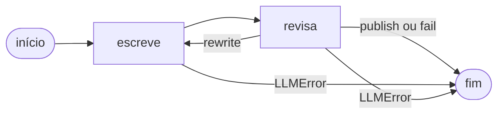

# T24 - Monte o grafo de geração, que escreve, revisa e reescreve uma vez

## Contexto

`docs/ARCHITECTURE.md` define os passos 7 a 9 de uma geração. `escreve` gera o JSON, `revisa` confere cada afirmação e o backend decide publicar, reescrever uma vez ou falhar. `write_content` (T20), `review_content` (T21) e as funções de decisão (T04) já existem separadas. T40 atualiza os contratos de revisão e decisão antes deste ticket.

Este ticket entrega essa ligação como um grafo LangGraph. T28 liga a tarefa de fundo ao grafo e usa `publish_content` (T22) quando a decisão é publicar. T29 acrescenta a etapa `planeja`.

A decisão de usar LangGraph está na tabela "Decisões" de `docs/ARCHITECTURE.md`: o briefing lista agentes com LangGraph como diferencial, e o grafo deixa o fluxo visível.

Depois de T40, T24 e T25 podem rodar em paralelo. T28 depende do grafo de T24 e do suporte a quiz de T26.

Leia antes: `docs/ARCHITECTURE.md`, seções "A criação de um curso segue doze passos" e "Regras que o código mantém", `docs/product-specs/fidelidade-e-qualidade.md` e `docs/tickets/completed/T40-regras-de-fidelidade.md`.

## Escopo

- Um grafo com os nós `escreve` e `revisa` e a decisão depois de `revisa`.
- No máximo duas escritas e duas revisões por geração.
- A conversão de um erro do modelo em falha, com mensagem.
- A dependência `langgraph`.

## Fora do escopo

- Buscar os chunks (T03, pronto) e montar o `WriteRequest` a partir do banco (T28).
- Publicar (T22, pronto) e marcar o conteúdo como `running` ou `failed` (T28).
- A etapa `planeja` (T29).
- Mudar as regras de decisão. Elas são de T40.
- Flashcards e quiz no `escreve` (T25 e T26). O grafo não depende do formato.

## Contrato

### Módulos que este ticket usa

Contratos de T20 e T40. O código deste ticket chama esses módulos sem alterá-los.

```python
# app.core.llm
class LLMError(Exception): ...


# app.services.writer
@dataclass(frozen=True, slots=True)
class WriteRequest:
    content_format: ContentFormat
    focus: str
    audience_level: AudienceLevel
    niche_name: str
    niche_prompt_hint: str
    chunks: Sequence[RetrievedChunk]


@dataclass(frozen=True, slots=True)
class Rewrite:
    previous: GeneratedBase
    unsupported_claims: Sequence[str]


def write_content(
    request: WriteRequest, *, rewrite: Rewrite | None = None
) -> GeneratedBase: ...


# app.services.reviewer (T40)
def review_content(
    *,
    generated: GeneratedBase,
    audience_level: AudienceLevel,
    focus: str,
    chunks: Sequence[RetrievedChunk],
) -> ReviewResult: ...


# app.services.grounding (T40)
MAX_ATTEMPTS = 2


class ReviewResult(BaseModel):
    claims: list[ClaimReview]
    clarity: ClarityLevel
    review_notes: str
    focus_covered: bool


class Decision(StrEnum):
    publish = "publish"
    rewrite = "rewrite"
    fail = "fail"


@dataclass(frozen=True, slots=True)
class GroundingReport:
    score: Decimal
    passed: bool
    focus_covered: bool
    supported: list[ClaimReview]
    unsupported: list[ClaimReview]
    cited_chunk_ids: list[uuid.UUID]


def evaluate(
    review: ReviewResult, valid_chunk_ids: Set[uuid.UUID]
) -> GroundingReport: ...


def decide(report: GroundingReport, *, attempt: int) -> Decision: ...


def failure_message(report: GroundingReport) -> str: ...
```

`decide` só devolve `publish` se o material cobre o foco, há pelo menos uma afirmação e todas têm apoio. Com foco não coberto, a primeira tentativa já termina em `fail`. `rewrite` só pode sair na tentativa 1.

### Módulo que este ticket cria

Em `backend/app/services/generation_graph.py`:

```python
@dataclass(frozen=True, slots=True)
class GenerationResult:
    decision: Decision  # publish ou fail, nunca rewrite
    attempts: int  # escritas começadas: 1 ou 2
    generated: GeneratedBase | None  # a última versão escrita
    review: ReviewResult | None  # a revisão dessa versão, quando concluída
    report: GroundingReport | None  # o relatório dessa revisão, quando concluída
    error_message: str | None  # texto para course_content.error_message


def generate_content(request: WriteRequest) -> GenerationResult: ...
```

T28 chama `generate_content(request)`. Com `decision == publish`, `generated`, `review` e `report` estão preenchidos e `error_message` é `None`. T28 passa esses dados e `request.chunks` a `publish_content`, junto com a sessão, o armazenamento e o identificador do conteúdo. Com `decision == fail`, T28 grava `error_message` no conteúdo.

### O grafo

Use `langgraph.graph.StateGraph`, com um estado próprio deste módulo (`TypedDict`). Compile o grafo uma vez, no nível do módulo. Não use checkpointer: a geração roda inteira em uma chamada.



1. `escreve`: soma 1 a `attempt` e chama `writer.write_content(request)` na tentativa 1. Na tentativa 2, chama `writer.write_content(request, rewrite=Rewrite(previous=<versão anterior>, unsupported_claims=[c.claim for c in report.unsupported]))`.
2. `revisa`: chama `reviewer.review_content(generated=..., audience_level=request.audience_level, focus=request.focus, chunks=request.chunks)`. Depois chama `evaluate(review, {c.chunk_id for c in request.chunks})` e `decide(report, attempt=attempt)`.
3. Depois de `revisa`: `rewrite` volta a `escreve`. `publish` e `fail` terminam.

Regras:

- A reescrita usa os mesmos chunks da primeira escrita. Não há nova busca (regra 7 de `docs/ARCHITECTURE.md`).
- Uma geração faz no máximo duas chamadas a `write_content` e duas a `review_content` (regra 8). Uma geração que publica na tentativa 1 faz uma de cada.
- Com `fail` decidido por `decide`, `error_message` é `failure_message(report)`.
- Um `LLMError` de `write_content` ou de `review_content` termina a geração com `decision == fail` e `error_message` igual a `f"Não foi possível gerar o conteúdo. {error}"`. As mensagens de `llm.py` são em português e não trazem o texto enviado. Um erro de `revisa` nunca aprova (regra 5) e não leva a uma reescrita: reescrever não conserta um erro do modelo.
- Mantenha juntos a versão escrita, sua revisão e seu relatório. Uma escrita bem-sucedida substitui `generated` e limpa `review` e `report` até a revisão terminar. Se a reescrita falhar, devolva os três valores da primeira tentativa. Se a revisão falhar, devolva a última versão escrita, com `review` e `report` iguais a `None`. Se a primeira escrita falhar, os três campos são `None`.
- Outras exceções, como `ValueError` e `UnsupportedFormatError`, saem de `generate_content` sem mudança. Elas indicam um erro de quem chama, e T28 trata.
- `GenerationResult.decision` nunca é `rewrite`.
- O módulo usa `escreve` e `revisa` para as chamadas ao modelo. A tarefa de fundo cuida do banco e da OCI.
- No retorno do grafo, registre em `INFO` a decisão, o número de tentativas e as contagens de afirmações sustentadas e sem apoio, quando houver relatório. Registre só esses dados.

## Detalhes técnicos

- Chame os agentes pelo módulo: `from app.services import reviewer, writer` e `writer.write_content(...)`. Os testes trocam `app.services.writer.write_content` e `app.services.reviewer.review_content` com `monkeypatch.setattr`.
- Acrescente `langgraph>=1.2.23,<2.0.0` às dependências de `backend/pyproject.toml`. Na raiz, rode `uv lock --upgrade-package 'langgraph==1.2.23'` para gravar a versão verificada. Em caso de conflito no lockfile, faça `rebase` no `master` e rode o mesmo comando.
- A [versão 1.2.23](https://pypi.org/project/langgraph/1.2.23/) instalou em uma cópia do ambiente do projeto com CPython 3.14.8. Um `StateGraph` compilou e executou duas iterações. Rode o teste do grafo no Python 3.14 do CI.
- Não edite `writer.py`, `reviewer.py`, `grounding.py`, `publishing.py`, `content_schemas.py` nem `llm.py`.
- O hook gera o cliente do frontend de novo. O OpenAPI não muda, então `frontend/src/client/` não pode aparecer no diff.
- Nenhum teste chama o Gemini.

## Critérios de aceite

- [ ] `generate_content` cumpre o contrato e devolve `publish` ou `fail`, nunca `rewrite`.
- [ ] Nenhuma geração passa de duas escritas e duas revisões.
- [ ] Um conteúdo com afirmação sem apoio depois da reescrita não sai como `publish`.
- [ ] Um erro do modelo sai como `fail`, com mensagem e com os dados da última versão escrita, quando houver.
- [ ] O grafo usa `StateGraph` do LangGraph. O manifesto declara a dependência e o `uv.lock` registra a versão 1.2.23.
- [ ] Nenhum teste chama o Gemini.
- [ ] Os hooks e os testes passam, com cobertura de 90% ou mais.

## Cenários de teste

Em `backend/tests/services/test_generation_graph.py`. Os cenários 1 a 10 trocam `write_content` e `review_content` por funções falsas que guardam os argumentos e devolvem valores fixos, em sequência.

1. A primeira revisão tem todas as afirmações sustentadas e o foco coberto: `publish`, 1 tentativa, uma chamada de cada agente. `generated`, `review` e `report` são os da primeira versão, e `error_message` é `None`.
2. A primeira revisão tem 2 afirmações sem apoio, e a segunda tem todas sustentadas: `publish`, 2 tentativas. A segunda chamada de `write_content` recebe `rewrite` com a primeira versão e as 2 afirmações. O resultado traz a segunda versão e a avaliação dela.
3. As duas revisões têm uma afirmação sem apoio: `fail`, 2 tentativas, duas chamadas de cada agente. `error_message` é `failure_message` do segundo relatório.
4. A primeira revisão tem `focus_covered=False`: `fail`, 1 tentativa, uma chamada de cada agente. `error_message` é "O documento não trata do assunto pedido."
5. As duas chamadas de `review_content` recebem os mesmos `chunks`, o `focus` e o `audience_level` do pedido.
6. `write_content` levanta `LLMError("falha X")` na tentativa 1: `fail`, zero revisões, `error_message` igual a "Não foi possível gerar o conteúdo. falha X" e os três campos de resultado iguais a `None`.
7. `review_content` levanta `LLMError` na tentativa 1: `fail`, uma chamada de cada agente, a primeira versão e os campos de revisão e relatório iguais a `None`.
8. `review_content` levanta `LLMInvalidResponseError` na tentativa 2: `fail`, duas chamadas de cada agente, a segunda versão e os campos de revisão e relatório iguais a `None`.
9. `write_content` levanta `LLMError` na tentativa 2: `fail`, duas escritas iniciadas e uma revisão. O resultado mantém a primeira versão, a revisão e o relatório dela.
10. `write_content` levanta `ValueError`: o erro sai de `generate_content` sem mudança.

O cenário 11 troca só `app.core.llm.generate_structured`, para passar pelos agentes reais. A função falsa responde conforme o `response_model`: `GeneratedTutorial` para `escreve` e `_ReviewOut` de `app.services.reviewer` para `revisa`.

11. A primeira revisão marca um fato como sem apoio e a segunda marca tudo como sustentado. Ambas indicam foco coberto. O grafo devolve `publish` após 4 chamadas a `generate_structured`. O `prompt` da segunda escrita traz o fato sem apoio.
